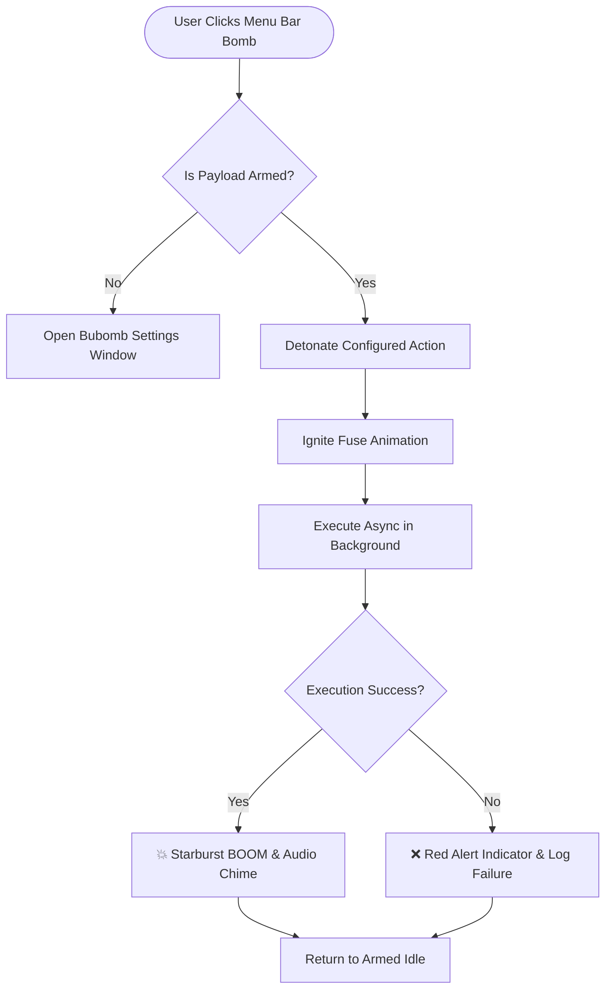
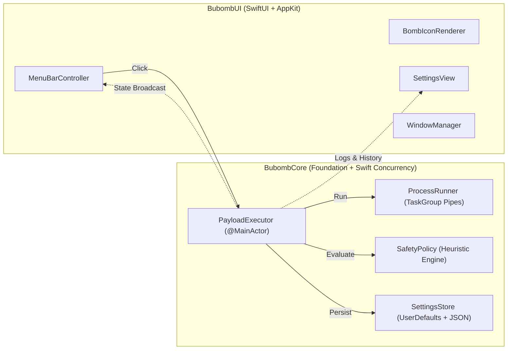

<div align="center">


# 💣 BUBOMB

### **Configure the boom.**

*A native, ultra-minimal macOS menu bar utility designed for instant, zero-latency detonation of your most critical action.*

<br/>

[](https://apple.com)
[](https://swift.org)
[](https://github.com/gigagamerchaddhruv-spec/bubomb)
[-7A5AF8?style=for-the-badge)](https://github.com/gigagamerchaddhruv-spec/bubomb)
[](LICENSE)

<br/>

> **"One bomb. One configured action. One click. BOOM."**

<br/>

[Key Highlights](#-why-bubomb) •
[Menu Bar Experience](#-menu-bar-experience) •
[Architecture](#-system-architecture) •
[Payload Engines](#-supported-payloads) •
[Quick Recipes](#-battle-tested-recipes) •
[Installation & Build](#-build--quickstart)

<br/>

---

</div>

<br/>

## ⚡ The Philosophy

Most automation tools on macOS have become bloated command centers. You trigger a hotkey, wait for a spotlight modal to render, type a search query, select an item from a list, press Enter, and wait.

**Bubomb cuts through the noise.**

You configure what matters **once**. When that moment comes—deploying code, launching a deep-work stack, blowing away docker caches, or firing a build pipeline—you simply click the tiny bomb resting quietly in your menu bar. 

**Zero searching. Zero modals. Immediate detonation.**

<br/>

```
  Traditional Menu Bar Tools                     Bubomb
 ┌───────────────────────────┐         ┌─────────────────────────┐
 │ 1. Click menu item        │         │ 1. Click the bomb.      │
 │ 2. Scroll through 15 items│   vs    │                         │
 │ 3. Open sub-menu          │         │ 💥 BOOM. Done.          │
 │ 4. Confirm dialog         │         └─────────────────────────┘
 │ 5. Wait for output...     │
 └───────────────────────────┘
```

<br/>

---

## ✨ Why Bubomb?

| Feature | What You Get |
| :--- | :--- |
| 🎯 **Instant Detonation** | Left-click detonates directly with **0ms interaction delay**. No intermediate dropdowns. |
| 🔌 **True macOS Native** | Built in **Swift 6**, **SwiftUI**, and **AppKit** (`NSStatusItem`). 100% Cocoa. |
| 🪶 **Featherweight** | Tiny memory footprint (~18MB RAM), 0% idle CPU, no Electron or web wrappers. |
| 🎨 **Dynamic Vector Bomb** | Silhouette adapts natively to Light and Dark macOS menu bars. Dynamic burning fuse sparks and explosion burst animations. |
| 🛡️ **Subprocess Armor** | Pipe deadlock protection, asynchronous stream drains, supervisor timeouts, and SIGKILL safety nets. |
| ⚠️ **Destructive Guard** | Automated heuristic scanning guards against catastrophic patterns (`rm -rf /`, `dd`, fork bombs). |
| 🔒 **100% Offline & Sovereign** | No servers, no telemetry, no cloud keys. All logs and scripts stay on your Mac. |

<br/>

---

## 🖥 Menu Bar Experience

Bubomb lives as an unobtrusive status accessory (`LSUIElement = true`), leaving your Dock clean.



### Direct Clicks vs. Power Menu

* **Normal Left-Click:** Detonates the configured payload immediately. If no payload is armed, opens the Settings window.
* **Right-Click / Control-Click:** Unfurls the utility power menu:
  * 💣 `Bubomb — Configure the boom`
  * 💥 `Detonate Payload (Return)`
  * ⚙️ `Settings... (Cmd+,)`
  * ⏹️ `Cancel Running Task (during execution)`
  * 🚪 `Quit Bubomb (Cmd+Q)`

<br/>

---

## 🎨 Iconography & Animation Engine

Bubomb features original vector artwork designed for crisp rendering at 18×18pt menu bar dimensions:

* **Idle (Template):** Minimalist monochrome bomb silhouette matching your system accents.
* **Detonating (Burning):** High-speed animated fuse ignition with warm orange (`#FF6B00`) and amber (`#FFAA00`) sparks flickering at 120ms intervals.
* **Completion (Success):** Tasteful 8-ray starburst explosion animation, accompanied by a subtle completion sound.
* **Completion (Failure):** Subtle warning badge indicating a non-zero exit status or timeout.
* **Accessibility:** Fully honors macOS `Reduce Motion` preference (`accessibilityDisplayShouldReduceMotion`).

<br/>

---

## 🧩 Supported Payloads

Bubomb includes five typed, extensible payload engines:

### 1. 💻 Shell Command
Direct binary execution or explicit shell invocation (`/bin/zsh`, `/bin/bash`, `/bin/sh`).
- Working directory selection with directory picker.
- Parameterized arguments array.
- Custom environment variable key-value table.
- Configurable execution timeouts (5s to 120s or infinite).

### 2. 🚀 Open Application
Instant native app launching via `NSWorkspace`.
- Pick applications from `/Applications` with macOS file panel.
- Pass custom launch arguments to binaries.

### 3. 🌐 Open Web Destination
Opens validated HTTP and HTTPS destinations in your default macOS browser.
- Live URL scheme and host validator.

### 4. 📜 Run Local Script
Execute scripts (`.sh`, `.py`, `.rb`, `.zsh`, `.pl`) safely.
- Automatic shebang detection (`#!/usr/bin/env python3`).
- Automatic interpreter resolution without silently mutating file permissions.

### 5. ⛓️ Multi-Step Sequence
Chain multiple diverse actions in deterministic order.
- Reorder steps with drag / arrows.
- Live progress reporting (`Step 2 of 4: Running Build...`).
- Configurable failure policy: `stopOnError` or `continueOnError`.

<br/>

---

## 🏛 System Architecture

Bubomb is structured as a decoupled Swift package:



### Concurrency & Deadlock Elimination
Many macOS apps freeze when subprocesses output large streams because Foundation's `Pipe` buffer (64 KB) fills up before exit. Bubomb uses concurrent non-blocking `readabilityHandler` streams and modern Swift `TaskGroup` routines to drain output buffers in real time, guaranteeing zero UI stalls.

<br/>

---

## 🍳 Battle-Tested Recipes

Here are a few popular payloads Bubomb users keep armed:

### Recipe 1: The "Emergency Production Reset"
```bash
# Type: Shell Command
docker compose down -v && docker compose up -d --build
```

### Recipe 2: The "Deep Work Workspace"
```
Type: Multi-step Sequence
1. Open App: /Applications/Visual Studio Code.app
2. Open App: /System/Applications/Utilities/Terminal.app
3. Open URL: https://linear.app/my-team/inbox
4. Shell Command: cd ~/code/core && git pull --rebase
```

### Recipe 3: The "Flush All macOS Caches"
```bash
# Type: Shell Command
dscacheutil -flushcache && sudo killall -HUP mDNSResponder
```

<br/>

---

## 🧪 Comprehensive Test Suite

Bubomb includes 29 automated tests verifying every aspect of validation, safety heuristics, process supervision, timeouts, and sequential execution.

```bash
make test
```

```
💣 Running Bubomb Test Suite...

• PayloadValidationTests
  ✓ testEmptyPayloadNameThrows (0.000s)
  ✓ testEmptyCommandThrows (0.000s)
  ✓ testValidShellCommandPasses (0.000s)
  ✓ testNonExistentShellThrows (0.000s)
  ✓ testNonExistentWorkingDirectoryThrows (0.000s)
  ✓ testInvalidURLThrows (0.000s)
  ✓ testValidURLPasses (0.000s)
  ✓ testNonExistentScriptThrows (0.000s)
  ✓ testEmptySequenceThrows (0.000s)

• SettingsStoreTests
  ✓ testInitialSettings (0.004s)
  ✓ testSaveAndRetrieveActivePayload (0.004s)
  ✓ testExecutionHistoryCap (0.041s)
  ✓ testClearHistory (0.005s)
  ✓ testResetToDefaults (0.004s)

• ProcessRunnerTests
  ✓ testSuccessfulCommandExecution (0.068s)
  ✓ testShellCommandExecutorWithArguments (0.073s)
  ✓ testNonZeroExitStatusThrows (0.067s)
  ✓ testEnvironmentVariablesPassedToProcess (0.083s)
  ✓ testWorkingDirectory (0.068s)
  ✓ testProcessTimeout (0.346s)
  ✓ testProcessCancellation (0.135s)

• URLLauncherTests
  ✓ testValidURLs (0.000s)
  ✓ testInvalidURLs (0.000s)

• SafetyPolicyTests
  ✓ testDestructiveCommandsDetected (0.005s)
  ✓ testSuspiciousCommandsDetected (0.001s)
  ✓ testSafeCommandsPass (0.003s)

• SequenceExecutorTests
  ✓ testSuccessfulSequentialExecution (0.141s)
  ✓ testSequenceStopsOnErrorWhenConfigured (0.065s)
  ✓ testSequenceContinuesOnErrorWhenConfigured (0.073s)

--------------------------------------------------
💥 All 29 tests passed in 1.19s! BOOM!
```

<br/>

---

## 🚀 Build & Quickstart

### Prerequisites
* macOS 14.0 (Sonoma) or newer.
* Xcode Command Line Tools or full Xcode.

### 1. Build and Run
```bash
git clone git@github.com:gigagamerchaddhruv-spec/bubomb.git
cd bubomb

# Build and assemble Bubomb.app release bundle
make app

# Launch in your menu bar
make run
```

### 2. Available Make Targets
```bash
make build    # Compile debug build via SwiftPM
make test     # Run all 29 automated test cases
make app      # Package and ad-hoc sign Bubomb.app
make run      # Launch Bubomb.app
make clean    # Remove build artifacts
```

<br/>

---

## ⌨️ Keyboard Shortcuts

| Shortcut | Action |
| :--- | :--- |
| `Cmd + S` | Save active payload configuration |
| `Cmd + Return` | Test / detonate payload from settings |
| `Cmd + 1` | Switch to **Payload** tab |
| `Cmd + 2` | Switch to **Execution Log** tab |
| `Cmd + 3` | Switch to **General** tab |
| `Cmd + W` | Close Settings window (Bubomb stays armed in menu bar) |
| `Cmd + Q` | Quit Bubomb completely |

<br/>

---

## 🔒 Security & Privacy Policy

* **No Privileged Escalation:** Bubomb never invokes `sudo` or requests root privileges automatically.
* **No Telemetry:** Bubomb contains zero analytics, tracking beacons, or remote logging.
* **Integrity Guard:** Evaluates shell payloads for destructive triggers (`rm -rf ~`, formatting drives) and requires deliberate user override before detonation.
* **Gatekeeper Friendly:** Ad-hoc signed out-of-the-box, fully compatible with Apple Silicon and modern macOS runtime protections.

<br/>

---

<div align="center">

**Bubomb** is crafted with ❤️ for developers who love speed, simplicity, and clean macOS design.

*"Configure the boom. Click the bomb. Get the result."*

[⭐ Star on GitHub](https://github.com/gigagamerchaddhruv-spec/bubomb) • [Report Issue](https://github.com/gigagamerchaddhruv-spec/bubomb/issues)

</div>
